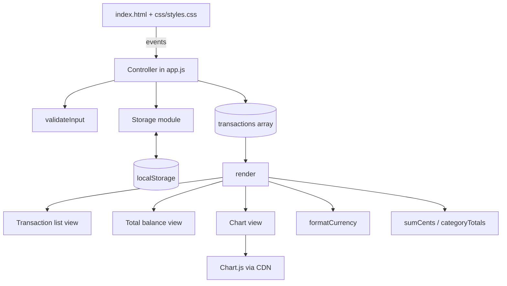
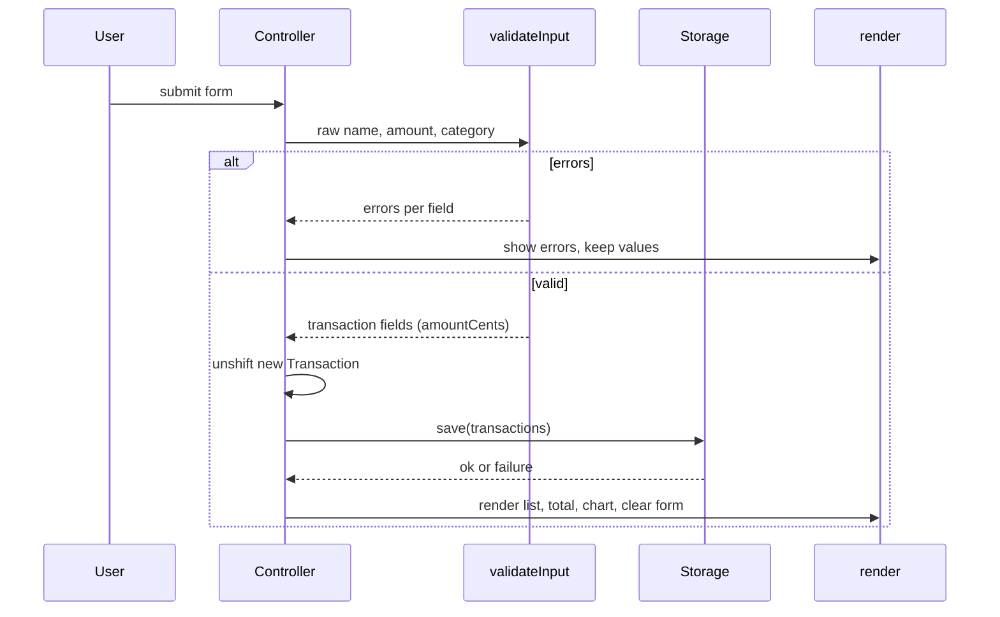

# Design Document

## Overview

The Expense & Budget Visualizer is a single-page, client-side app built with HTML, CSS, and vanilla JavaScript. It has no backend and no build step. Transactions are persisted in `localStorage`, and a pie chart of spending by category is drawn with Chart.js.

Key design decisions:

- **Fixed file layout.** `index.html` at the root, exactly one stylesheet `css/styles.css`, exactly one script `js/app.js`. Chart.js is loaded from a CDN `<script>` tag, so it does not add a file to `js/` (Req 7.1 to 7.3).
- **Pure core, thin shell.** Validation, formatting, totals, category aggregation, and (de)serialization are pure functions with no DOM or storage access. DOM rendering, Storage access, and Chart.js calls are isolated in a small imperative layer. This makes the logic testable with property-based tests.
- **Single state, full re-render.** A single in-memory `transactions` array is the source of truth. Every change calls one `render()` which redraws the list, total, and chart. With up to 500 transactions this is well within the 100 ms budget (Req 8.3).
- **Money as integer cents.** Amounts are validated from the input string and converted to integer cents for summation, to avoid floating-point drift (Req 4.2). Cents are stored internally; the formatter converts back to a two-decimal string.
- **Testable without a build.** `app.js` exposes its pure functions on a single `window.ExpenseApp` object, and also assigns `module.exports` when `typeof module !== 'undefined'`, so tests can load it in Node without changing the browser behavior. Test files live in a top-level `tests/` folder, not in `js/` or `css/`, so the shipped layout still has exactly one JS file in `js/` and one CSS file in `css/`.

Research summary: Chart.js v4 is distributed as a UMD bundle at `https://cdn.jsdelivr.net/npm/chart.js`, which exposes a global `Chart`. A `pie` chart takes `data.labels` and `data.datasets[0].data/backgroundColor`, and `chart.update()` redraws after data mutation. `chart.destroy()` releases the canvas. If the CDN fails to load, the global `Chart` is `undefined`, which is the detection point for Req 5.8. `localStorage` access can throw (`SecurityError` when disabled, `QuotaExceededError` when full), so every access is wrapped in `try/catch`. Sources: [Chart.js docs](https://www.chartjs.org/docs/latest/), [MDN Web Storage API](https://developer.mozilla.org/en-US/docs/Web/API/Web_Storage_API). Content was rephrased for compliance with licensing restrictions.

## Architecture



Flow for adding a transaction:



Layers inside `js/app.js`:

1. **Pure logic**: `validateInput`, `parseAmountToCents`, `formatCurrency`, `sumCents`, `categoryTotals`, `serialize`, `deserialize`, `generateId`.
2. **Storage**: `loadTransactions`, `saveTransactions` (wrap `localStorage`).
3. **View**: `renderList`, `renderTotal`, `renderChart`, `showFormErrors`, `showBanner`.
4. **Controller**: event wiring on `DOMContentLoaded`, `addTransaction`, `deleteTransaction`.

## Components and Interfaces

### index.html

Page order top to bottom (Req 4.1, 8.1):

1. `<noscript>` message: "JavaScript is required to use this app." (Req 7.6)
2. `<header>` with Total Balance (`#total-balance`), styled at least 1.5x body font size.
3. Status banner `#banner` (`role="status"`) for storage messages.
4. `<form id="input-form" novalidate>` with labelled fields: `#item-name` (`maxlength="100"`), `#amount` (`type="text"`, `inputmode="decimal"`, so our own validation produces the specified errors), `#category` (`<select>` with an empty placeholder option plus Food, Transport, Fun), and a submit button. Each field has a visible `<label>` and an adjacent `<span class="error" aria-live="polite">`.
5. `<ul id="transaction-list">` inside a fixed-height scroll container (`overflow-y: auto`), plus `#empty-state` message.
6. `<canvas id="spending-chart">` and `#chart-message` placeholder.
7. `<link rel="stylesheet" href="css/styles.css">`, the Chart.js CDN script, then `<script src="js/app.js">`.

### css/styles.css

Body font 16px or larger, text/background contrast of 4.5:1 or better, a single-column responsive layout with no horizontal scroll from 360 to 1920 px, `overflow-wrap: anywhere` on item names (Req 2.6), and the list container with `max-height` and `overflow-y: auto` (Req 2.2). Below 360 px, `body` permits horizontal scroll (Req 8.7).

### JavaScript interfaces (`js/app.js`)

```js
// Constants
const CATEGORIES = ['Food', 'Transport', 'Fun'];
const STORAGE_KEY = 'expense-visualizer.transactions.v1';
const MAX_CENTS = 99999999999; // 999,999,999.99

// Pure
parseAmountToCents(str)      // -> { ok: true, cents } | { ok: false, reason: 'empty'|'nonnumeric'|'nonpositive'|'range'|'precision' }
validateInput({ name, amount, category })
                             // -> { valid: true, value: { name, amountCents, category } }
                             //  | { valid: false, errors: { name?, amount?, category? } }
formatCurrency(cents)        // -> "$1,234.50"
sumCents(transactions)       // -> integer cents
categoryTotals(transactions) // -> { Food: cents, Transport: cents, Fun: cents }
serialize(transactions)      // -> JSON string
deserialize(text)            // -> { ok: true, transactions } | { ok: false }
generateId()                 // -> unique string

// Storage
loadTransactions()           // -> { transactions, status: 'ok'|'empty'|'corrupt' }
saveTransactions(list)       // -> true | false (never throws)

// View
render()                     // redraws list, total, and chart from state
renderChart(totals)          // create/update/destroy Chart.js instance, handle failure

// Controller
addTransaction(rawInput)
deleteTransaction(id)
```

Behavior notes:

- **Validation** trims the name, rejects empty/whitespace names, and caps at 100 characters. The amount string must match `^\d+(\.\d{1,2})?$` after trimming; empty gives the "empty" error, non-matching text without a precision issue gives "nonnumeric", `0` gives "nonpositive", more than 2 decimals gives "precision", and over `MAX_CENTS` gives "range". A negative sign is caught by a pre-check so it reports "must be greater than zero". All invalid fields are reported simultaneously (Req 1.9), and on failure the form values are untouched (Req 1.4 to 1.8).
- **Total** displays `formatCurrency(sumCents)`. If the sum exceeds `MAX_CENTS`, the view shows "Maximum displayable balance exceeded" and leaves transactions untouched (Req 4.8).
- **List** inserts new transactions at the front (`unshift`), so the first entry is newest (Req 2.3). Each `<li>` shows name (via `textContent`, never `innerHTML`, to avoid XSS), formatted amount, category, and a `<button type="button">` delete control, which supports Enter and Space natively (Req 3.1). The empty-state element is shown only when the list is empty (Req 2.4, 2.7).
- **Chart** shows only categories with a total above 0 (Req 5.4), with fixed colors per category and a legend. Slice values are the category cent totals, so Chart.js computes proportional shares (Req 5.3). With no data, the canvas is hidden and a placeholder is shown (Req 5.7). If `typeof Chart === 'undefined'` or construction throws, a "chart unavailable" message is shown and data is left unchanged (Req 5.8). The chart instance is reused and updated with `chart.update()` for speed.
- **Storage** `saveTransactions` catches errors and returns `false`; the controller then shows "Data was not saved" while keeping the in-memory change (Req 6.4). `loadTransactions` returns `empty` with no message when the key is absent (Req 6.5), and `corrupt` with a "saved data could not be loaded" banner on parse or shape failure (Req 6.3). All data stays in the browser (Req 6.6).

## Data Models

```js
/**
 * @typedef {Object} Transaction
 * @property {string} id           Unique identifier (crypto.randomUUID() when available, else timestamp + counter)
 * @property {string} name         Trimmed item name, 1 to 100 chars
 * @property {number} amountCents  Integer, 1 to 99999999999
 * @property {'Food'|'Transport'|'Fun'} category
 */
```

Storage format: `localStorage[STORAGE_KEY]` holds `JSON.stringify(transactions)`, an array of `Transaction` objects, ordered newest first (same as display order).

`deserialize` validates that the parsed value is an array and every element has a string `id`, a string `name` of 1 to 100 chars, an integer `amountCents` in range, and a `category` in `CATEGORIES`. Any failure returns `{ ok: false }` and the whole stored list is discarded for that session (Req 6.3).

In-memory state:

```js
let transactions = [];   // Transaction[], newest first
let chart = null;        // Chart.js instance or null
```

The amount the user types ("12.5") is converted to cents (1250) at validation time. `formatCurrency` renders `Math.floor(cents / 100)` with thousands separators and `cents % 100` padded to two digits, so output always has exactly two decimals (Req 2.5, 4.3).

## Correctness Properties

*A property is a characteristic or behavior that should hold true across all valid executions of a system-essentially, a formal statement about what the system should do. Properties serve as the bridge between human-readable specifications and machine-verifiable correctness guarantees.*

### Property 1: Valid input is accepted and normalized

For any item name with 1 to 100 characters including at least one non-whitespace character, any amount string with a value above 0 up to 999,999,999.99 and at most 2 decimal places, and any category in {Food, Transport, Fun}, `validateInput` returns valid with the trimmed name, the category, and `amountCents` equal to the amount multiplied by 100 as an exact integer.

**Validates: Requirements 1.2**

### Property 2: Invalid input is rejected with exactly the invalid fields reported

For any combination of name, amount, and category in which one or more fields are invalid (empty or whitespace-only name, empty or non-numeric amount, amount of 0 or less, amount above 999,999,999.99, amount with more than 2 decimals, or missing category), `validateInput` returns invalid, and its error set contains exactly the invalid fields, each of them at the same time.

**Validates: Requirements 1.4, 1.5, 1.6, 1.7, 1.8, 1.9**

### Property 3: Adding places the new transaction first and preserves the rest

For any existing list of transactions and any valid new transaction, adding it yields a list one longer whose first element is the new transaction and whose remaining elements equal the original list in the same order.

**Validates: Requirements 1.2, 2.3**

### Property 4: Deleting removes exactly the target transaction

For any list of transactions and any transaction in it, deleting it by id yields a list that does not contain that id and equals the original list with that single element removed, with all other transactions unchanged and in the same relative order.

**Validates: Requirements 3.2, 3.3**

### Property 5: Currency formatting is well-formed and lossless

For any integer cent value from 0 to 99999999999, `formatCurrency` returns a string with a currency symbol, thousands separators, and exactly two decimal places, and parsing the digits of the result back yields the original cent value.

**Validates: Requirements 2.5, 4.3**

### Property 6: Total equals the sum of amounts

For any list of transactions (including the empty list), `sumCents` equals the exact integer sum of the `amountCents` of every transaction, and equals 0 for the empty list. This also holds after any sequence of adds and deletes and after a storage round trip.

**Validates: Requirements 4.2, 4.4, 4.5, 4.6, 4.7, 3.5**

### Property 7: Rendered list shows each transaction with one delete control

For any list of transactions, the rendered list contains one entry per transaction, each entry's text includes the item name, the formatted amount, and the category, and each entry contains exactly one delete control.

**Validates: Requirements 2.1, 3.1**

### Property 8: Chart data reflects category shares and omits empty categories

For any list of transactions, the chart data contains exactly the categories whose summed amount is greater than 0, the value for each is that category's summed cents, the values add up to the overall total, and each category's share (value divided by total) equals its category sum divided by the sum of all amounts.

**Validates: Requirements 5.3, 5.4, 5.5, 5.6**

### Property 9: Storage serialization round trip

For any valid list of transactions, `deserialize(serialize(list))` succeeds and returns a list with the same length, the same order, and identical field values for every transaction. Consequently, a transaction deleted before saving is absent after loading.

**Validates: Requirements 6.7, 6.2, 3.4**

### Property 10: Malformed stored data is rejected

For any stored text that is not valid JSON, is not an array, or contains an element with a missing or wrongly typed field, an out-of-range amount, or an unknown category, `deserialize` returns a failure result and never a partial list.

**Validates: Requirements 6.3**

## Error Handling

| Situation | Handling | Requirement |
|---|---|---|
| Invalid form fields | Inline error beside each invalid field, all shown at once; no transaction added; entered values kept; errors cleared on next successful add | 1.3 to 1.9 |
| Stored data unparseable or wrong shape | Start with an empty list; banner "Saved data could not be loaded" | 6.3 |
| No stored data | Empty state, no message | 6.5 |
| `localStorage` write throws (quota or unavailable) | `saveTransactions` returns `false`; change stays in memory; banner "Data was not saved" | 6.4 |
| `localStorage` read throws | Treated like unreadable data (same banner as corrupt data) | 6.3 |
| Chart.js missing (CDN blocked) or constructor throws | Hide canvas, show "Chart unavailable"; list, total, and storage keep working | 5.8 |
| Total exceeds 999,999,999.99 | Show "Maximum displayable balance exceeded"; transactions untouched | 4.8 |
| JavaScript disabled | `<noscript>` message | 7.6 |
| `crypto.randomUUID` unavailable (older browsers, non-secure contexts) | Fall back to timestamp plus counter id | 7.5 |

User-supplied text is only inserted using `textContent`, so item names cannot inject markup. Errors from rendering the chart are caught at the `renderChart` boundary so they cannot stop the list and total from updating.

## Testing Strategy

The project uses a dual approach. Tests are dev-only and live in `tests/`, outside `js/` and `css/`; running them is optional and not needed to use the app.

**Property-based tests** use [fast-check](https://fast-check.dev/) with a standard runner such as Vitest or Jest (jsdom environment for Property 7). Pure-logic properties (1 to 6, 8 to 10) run against `app.js` loaded in Node. Each property is implemented by a single test, configured for at least 100 runs (`numRuns: 100`), and tagged with a comment in this format:

`// Feature: expense-budget-visualizer, Property N: <property text>`

Generators: names (strings including whitespace-only and over-length), amount strings (valid decimals, zero, negatives, over-max, three-plus decimals, non-numeric text), categories (the three values plus empty), transaction lists (up to 500 items), and malformed JSON or shapes for Property 10.

**Unit / example tests** (jsdom, mocked `localStorage` and `Chart`):

- Form markup: fields, 100-character limit, exactly three categories, visible labels (1.1, 8.5).
- Form clears and errors disappear after a successful add (1.3).
- Empty-state message shown with no transactions and removed after the first add (2.4, 2.7); chart placeholder when empty (5.7).
- Total shows 0.00 when empty; overflow message when the sum exceeds the max (4.6, 4.8).
- Chart is constructed as `pie` with distinct colors and legend labels (5.1, 5.2); missing `Chart` global shows "unavailable" and leaves data unchanged (5.8).
- Storage: `setItem` called after add and delete (6.1); a throwing `setItem` shows the not-saved banner and keeps the change (6.4); missing key gives no error (6.5); corrupt value gives the could-not-load banner (6.3).
- One render of 500 transactions finishes well under 100 ms (8.3).

**Smoke and manual checks** (not suitable for automation): file layout is `index.html`, `css/styles.css`, `js/app.js` only, with a single stylesheet link and a single app script tag plus the Chart.js CDN tag (7.1 to 7.3); no `fetch`/`XMLHttpRequest` usage (6.6); opening via `file://` in the latest two releases of Chrome, Firefox, Edge, and Safari with no console errors (7.4, 7.5); contrast, font size, scrolling list, long-name wrapping, no horizontal scroll from 360 to 1920 px, and load time (2.2, 2.6, 4.1, 8.1, 8.2, 8.4, 8.6, 8.7). Full accessibility validation needs assistive-technology testing and expert review.
